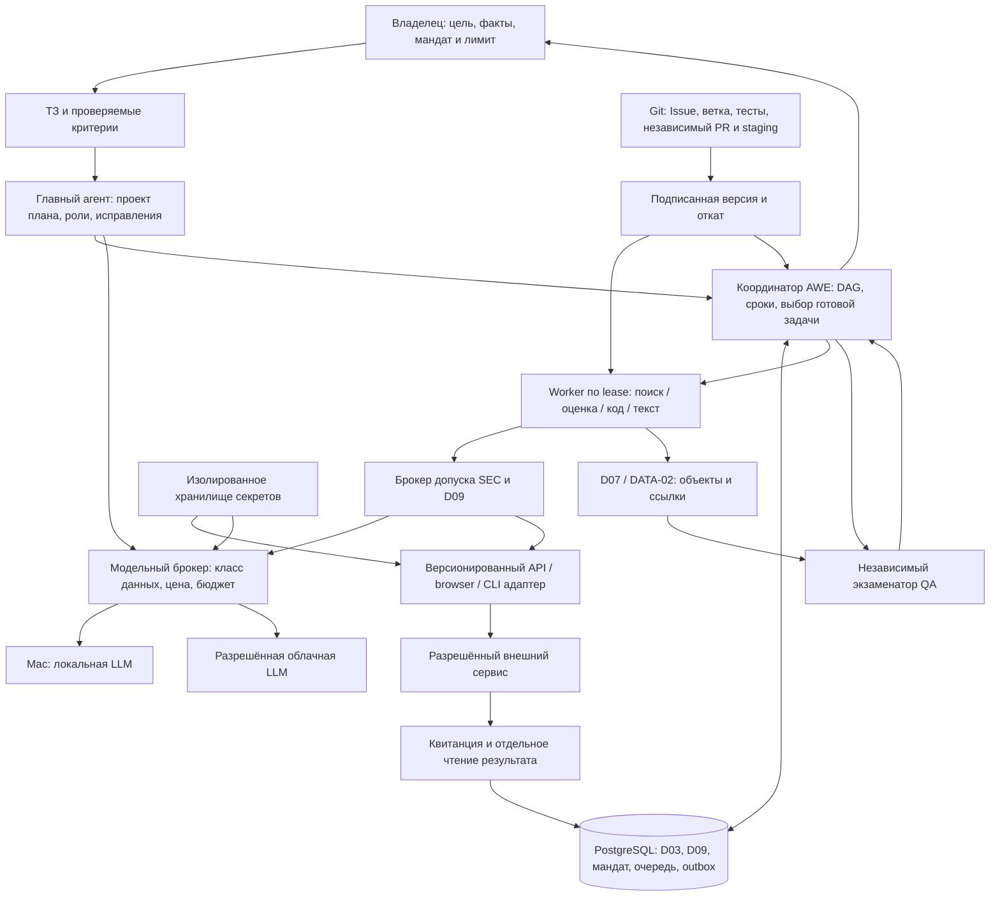

# C. Один координатор, сменные интеллектуальные исполнители

## Выбор архитектуры

| Вариант | Что покупаем инженерным временем | Слабое место | Решение |
|---|---|---|---|
| **A. Профиль E1 существующего координатора, PostgreSQL и простые workers** | Сохраняются D03/D09/SEC, существующие handoff и QA. Пишем небольшой claim loop, live transport, policy и адаптеры. Первый результат возможен с одним узлом и локальной моделью. | Самостоятельно реализовать жизненный цикл длинной миссии и fault-тесты. Горячий project snapshot ограничивает параллелизм. | **Выбрать для CAREER.** Сначала массив данных вакансий вне snapshot и максимум два независимых worker. |
| **B. Agno Team/Workflow + AgentOS как основной runtime** | Готовые Python agents, teams, parallel steps, durable service, approvals, resume. Полезно для новой линии без существующего координатора. | Потребуется смена владельца планирования, миграция lifecycle, сопряжение policy/receipts и Node↔Python. Два scheduler или два retry-контура способны воспроизвести эффект. | Реалистичный запасной вариант. Замена оправдана, если профиль A на одинаковых crash fixtures не обеспечивает lease/recovery или его развитие дороже. Сравнить на том же контракте, зафиксировать единственного писателя перед переключением. [Agno](https://docs.agno.com/) · [v3.1.12](https://github.com/agno-agi/agno/releases/tag/v3.1.12) |
| **C. Hermes как head и собственная делегация Hermes** | Есть delegate_task, параллельные дети, краткие итоги и профили. В поставке пользователя имеется Hermes/NIVICT. | У локального binding ограничения reconnect и наследование набора инструментов. Родительский cwd и фоновые действия требуют отдельной изоляции. Сессия и cron Hermes пересекаются с AWE. | В E1 применять по потребности как leaf для исследования/кодинга. Если budget/egress нельзя принудительно провести через AWE — оставить отключённым, пользоваться прямым модельным worker. [Установленный контракт](../awe/hermes_runtime/native-binding.mjs) · [Делегирование upstream](https://github.com/NousResearch/hermes-agent/blob/main/website/docs/user-guide/features/delegation.md) |

Upstream на момент проверки: Hermes v0.23.0 (5 ноября, MIT), Agno v3.1.12 (29 октября, Apache-2.0 в лицензии репозитория). Локальная ревизия Hermes установлена по Git, её совместимость с новым upstream не предполагается. Ни один из фреймворков не нужен для первого отправителя. Дополнительная очередь Redis/Kafka, отдельный сервис workflow или Temporal дают ещё один жизненный цикл. Возвращать их в обсуждение при измеренном узком месте очереди или нескольких независимых командах. [Hermes release](https://github.com/NousResearch/hermes-agent/releases/tag/v0.23.0) · [Hermes License](https://github.com/NousResearch/hermes-agent/blob/main/LICENSE) · [Agno License](https://github.com/agno-agi/agno/blob/main/LICENSE)

## Поток одной миссии

Все обращения к R, включая планирование и QA, получают в D09 scope и резерв. Результат H — недоверенное предложение (`roles, nodes, edges, budget, deadline, criteria`). Валидатор проверяет DAG, существование capability, актуальность источников и верхние лимиты. Детерминированный координатор публикует только runnable узлы. Права модели на прямой network, shell, credentials и изменение собственного бюджета отсутствуют.

**Количество агентов следует из работы.** Для одного нормализуемого источника хватает программы. Для независимых HH и ATS создаются два read-задания, дедупликация ждёт обе ветви или сохраняет coverage gap по истечении deadline. Для портфолио дизайн, frontend и backend могут исполняться в разных worktree, интеграционный тест ждёт их артефакты. Головной агент разбивает узел, если появилась новая специализация или независимая ветвь и резерв укладывается в лимит. Стартовый потолок предлагается в два одновременных worker, один send slot на владельца. Кандидаты из реестра ранжируются по capability, действующей версии, доступным ресурсам, проверенному качеству и цене. Новый агент получает manifest роли, разрешённые tools и ссылки контекста. Новая программа проходит обычную поставку.

**Где мыслит head.** При известных шаблонах CAREER отдавать извлечение и текущие решения локальной модели, переходы и мониторинг — коду. Для новой сложной цели или проваленного экзамена плана использовать один облачный вызов на разрешённых данных. Затем head работает по событиям: отсутствие прогресса, новая зависимость, ошибка качества. HH-материал остаётся локальным. Выбор по измеренному успеху и конфиденциальности приведён [в модельной политике](04-models.md).

## Один допуск на миссию

Предлагаемая запись `mission_grant` содержит `owner, project, mission_id, policy_version/hash, goal_hash, subject_roles, permitted_operations, source/data_classes, allowed_destinations, attachment_versions, external_count, spend_ceiling, valid_from/until, revocation_epoch`. Подпись владельца или аутентифицированное решение привязано к хешу. Сервер выдаёт краткоживущий job token, ограниченный пересечением мандата, роли и задачи. После падения повторная выдача разрешена только для активной миссии по current fence. Renew не сбрасывает ни счётчик действий, ни бюджет. Отзыв закрывает новые dispatch, уже начатые операции проходят readback.

| Класс | Типовые действия | Решение внутри мандата | Когда нужен владелец |
|---|---|---|---|
| Локальное обратимое | Извлечь, построить сайт в worktree, вывести черновик, проверить тестом | Автоматически в sandbox, TTL и лимит ресурсов | Новая область данных или назначение |
| Разрешённое чтение / оплачиваемая модель | GET вакансии, чтение статуса, обезличенный запрос LLM | Проверить источник, метод, data class, квоту, верхнюю стоимость. Перепроверка программная | Новый получатель данных, бюджет или аккаунт |
| Ограниченное первичное действие | Один первый отклик на каноническую вакансию | Передать адаптеру подписанное намерение, точный recipient, digest вложений, резерв и fencing. Сверить результат. Политика разрешает серию таких действий до лимита | Выход за канал/лимит/срок или неразрешимый неизвестный исход |
| Отдельное право | Публикация на указанном домене, новая версия ядра, выдача новых scopes | Изолированный релиз/разрешение на конкретное назначение | Владелец либо заранее назначенный независимый администратор |
| Диалог с работодателем | Ответ, follow-up, договорённость о времени | Только локальная заметка или черновик. Endpoint переписки отсутствует в send broker | В CAREER переписку ведёт сам владелец |

Сохранить проверку целостности артефактов, независимую QA, RLS/identity, CAS/fencing, предварительный резерв, suppression дубликатов и quarantine неизвестного исхода. Списки бинарных pins проверять при загрузке immutable worker и смене версии, scope/отзыв/TTL — на каждом действии. Отдельные PID/PGDATA fingerprint, лимит именно физических стартов, пересборка полного пакета всех receipts и ручное разрешение каждой lease относились к финализации сохранённой базы. В E1 их заменяют service identity, health/readiness и приёмочный тест новой версии. E0 остаётся закрытой историей.

Конкретная причина лишнего ручного цикла в E0 — controller создал exclusive reservation8 до отказа проверки относительного argv. PostgreSQL в тот момент не стартовал, но intent уже был израсходован и понадобилось отдельное append-only решение владельца. Для E1 проверять команды, capability, доступность артефакта и текущий grant до резерва. Различать программно доказанный pre-send abort, начатую передачу и неизвестный результат. Первый допускает отмену резерва по политике, два последних требуют сверки. Неизменяемая история при этом сохраняется. [Разбор prestart08](../MASTER-INTEGRATION-01/MASTER02/FINALIZATION/ADMISSION-BLOCKER-03.md)

## Три компьютера

| Узел и качество данных | Начальное размещение | Отключение |
|---|---|---|
| Windows-хост аудита, фактически CIM: i5-10300H 4C/8T, 34 188 828 672 B RAM (~31,84 GiB), GTX 1650 (~4 GiB по AdapterRAM), Intel UHD. SSD XPG ~1,02 TB и Micron ~512 GB. Активный Realtek GbE сообщил negotiated **10 Mbps**. | Кандидат на постоянно включённый central: один supervisor, **новая отдельная** PG-инсталляция/volume E1, очередь, broker, D07 objects и метрики. WSL с filesystem БД внутри Linux volume либо native PG service. Один local worker для read/CLI. Перед назначением измерить uptime, автозапуск, запас SSD и фактическое LAN. | Весь dispatch останавливается. Восстановить authority, объекты, epoch и проверить outbox. |
| MacBook Pro M4 Pro, 24 GB unified — данные владельца | Один Q4 inference worker, локальные RU-задачи и при надобности визуальный QA. Хранить модель на Mac, передавать компактные inputs. | Worker leases истекают. Облако доступно только подходящим классам данных. Для локальных HH и PII задача ждёт Mac или разрешённый CPU worker. |
| Второй ПК — CPU/RAM/GPU/диски, LAN и режим питания UNKNOWN | После inventory — изолированный Chromium/Playwright и build worker, зашифрованная копия backup на ином устройстве. При лучшем uptime допустимо назначить его central до запуска миссии. | Дочерние задания без эффекта получают новый lease. База остаётся единственной. |

**Один узел или распределение.** Вариант целиком на Windows проще восстанавливать и достаточен для небольшого пилота с разрешённым облаком, но локальная модель и Chromium делят ресурсы с БД. Полностью распределённый multi-primary сильно усложняет согласование внешних эффектов и восстановление после partition. Выбор — **один постоянный authority и распределённые stateless workers**, без автоматического повышения реплики на старте. Mac не обязан быть включён для чтения очереди и мониторинга. При 10 Mbps передача 1 GB в лучшем случае займёт около 13 минут. Реплицировать дельты и сжатые артефакты, не возить веса на каждый job. Это расчёт по negotiated link, пропускная способность между узлами не измерена.

Начать с private LAN/WireGuard, именованных ключей устройств, firewall deny-by-default и mTLS или коротких service tokens. Worker устанавливает исходящее соединение только с queue/API gateway. SQL-порт доступен только сервисным принципалам, браузер не видит vault и PG. Владельцу компьютеров достаточно предоставить машину для однократной инвентаризации. На Windows инженер выполняет `Get-CimInstance Win32_Processor`, `Get-CimInstance Win32_ComputerSystem`, `Get-CimInstance Win32_VideoController`, `Get-PhysicalDisk`, `Get-NetAdapter -Physical`. На Mac — `system_profiler SPHardwareDataType SPDisplaysDataType`, `sysctl hw.memsize`. Серийные номера не включать в отчёт. [Вариант политик для уже используемого tailnet](https://tailscale.com/docs/reference/syntax/policy-file)

## Память и границы данных

| Класс | Хранилище и доступ | Что восстанавливаем / что попадает в контекст |
|---|---|---|
| Авторитетное состояние, стоимость и эффекты | PostgreSQL D03/D09, проектные ACL/RLS, транзакции и уникальные индексы | Job, fencing, business ID, cursor, intent, receipt, spend. В head только агрегаты, причины HOLD и ссылки. |
| Исходные документы | Локальные зашифрованные объекты с provenance, TTL и лицензией источника | Полный оригинал может читать уполномоченный worker. При удалении источника оставить допустимый digest/дату по policy. |
| Артефакты | D07/CAS + catalogue entry в D03. Сначала durable bytes и hash, затем publish reference, orphan GC с grace | CV, build, screenshot, письмо как версии. QA перечитывает объект и сверяет digest. |
| Знания line / компании | DATA-02: версия, автор, источник, review, supersedes/expires, ACL | Результат исследования попадает в line. Повышение в общие знания — после независимой проверки, обезличивания и определения владельца. |
| Рабочий контекст | Краткоживущий task pack и working directory на worker | Цель, критерии, ≤5 релевантных refs, ограничения и counterexamples. Head получает outcome, confidence/uncertainty, cost, evidence refs и next decision. Предлагаемый предел отчёта 1 KiB плюс refs. Перечитывать детали по триггеру спора или ошибки. |
| Семантический поиск | Сначала Postgres FTS + фильтр проекта/доступа до retrieval. При измеренных промахах — pgvector или отдельный Supermemory adapter | Производный индекс перестраивается из допущенных объектов. Обязательны tombstone, запрет cross-project и source citations. |
| Секреты | Keychain/DPAPI либо секрет-хранилище под service identity. На Linux ключ разблокировки отдельный от backup | OAuth refresh/cookies и ключи доступны только адаптеру нужного origin. Worker получает handle с TTL. |
| Логи и evidence | Журнал переходов, технические metadata, хеш или внешняя ссылка с маскированием, отдельный доступ к private evidence | Сохранять request ID, классы, стоимость, timestamps и digest. Не логировать bearer, AUTH, cookie, полное письмо или CV. |

Supermemory пригодна как опциональный поиск/извлечение. Публичная документация разделяет hosted и self-hosted lite, указывает ограничения лицензии server binary, локальные embeddings и возможные внешние вызовы при извлечении/PDF. Для E1 дополнительная БД и провайдер усложняют удаление и контроль утечек. Повод включить — измеримый прирост recall@5 на закрытом наборе вопросов при сохранении ACL и гарантированном удалении. Фактический сервис AWE не проверен. [Supermemory self-host](https://github.com/supermemoryai/supermemory/blob/main/apps/docs/self-hosting/overview.mdx)

Для каждого поля хранить origin и допустимые назначения. Маркировки `PUBLIC_EXPORTABLE / LOCAL_ONLY / OWNER_PII / SECRET` и ограничения источника наследуются производными текстами, embeddings, screenshots и tool results. Для HH действует LOCAL_ONLY. Даже из общедоступной страницы нельзя автоматически сделать разрешённый cloud payload. Egress adapter собирает запрос по allowlist полей, проверяет метки после сериализации и redirect, ведёт redacted audit. Облако может получить разрешённое обезличенное ТЗ для программирования, синтетические тесты, публично разрешённый по источнику текст. Разрешение отправить работодателю CV не даёт разрешения передавать его модельному провайдеру.
