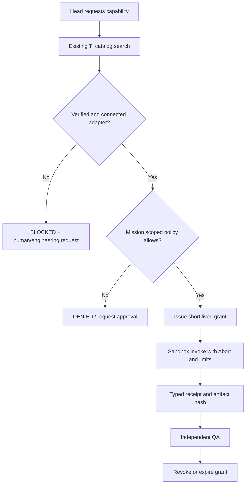

# R1-01 — Tool Gateway / Capability Broker

**Готовность документа:** DRAFT_READY_FOR_REVIEW. **Работающий Gateway:** NOT_VERIFIED / не заявляется. **R0** должен быть завершён, R1 owner-authorized до внедрения.

## Market-first correction — 2026-11-13

**Не начинать разработку самописного Capability Broker до native-audit**. Уже существуют Mastra `ToolSearchProcessor` (поиск/загрузка заранее зарегистрированных tools; >=1.58.0), `MCPClient`, встроенные human approvals и их передача через supervisor/subagents. Composio имеет официальный `@composio/mastra` адаптер, Pipedream Connect — готовые OAuth/API/MCP подключения, ToolHive — self-hosted MCP isolation. Выбрать минимум компонентов по реальному R0 checkout. **ToolSearchProcessor не превращает каталог 4504 кандидатов в разрешённые, подключённые tools и не является ACL**; оставшийся слой policy+scope+receipt лишь тогда минимально реализовать самим.

[Полный рыночный аудит со ссылками и таблицей Build/Buy](../RESEARCH/MARKET-REUSE-AUDIT-2026-11-13.md).

## 1. Какая пользовательская возможность будет разблокирована

В Nox можно дать задачу «создай и проверь сайт» — Head должен получить подходящий *реально исполнимый* инструмент (например, browser QA), ограниченное разрешение, конкретную инструкцию и настоящий результат с доказательствами, не обращаясь к OpenCode как исполнителю.

### Библиотекарь — не второй LLM-руководитель

- Head определяет *потребность*: `browser.inspect`, `files.write_workspace`, `code.run_tests`.
- **Tool Intelligence** возвращает кандидатов, provenance/источники, статус проверок.
- **Capability Broker** принимает формальный запрос, использует детерминированный PolicyGate, находит совместимый approved adapter, выдаёт ограниченный grant и записывает вызов.
- **Knowledge System / Skill** даёт инструкции и источники; их тексты не становятся правами доступа.
- **Adapter / sandbox worker** исполняет действие; QA оценивает результат отдельно.



## 2. Минимальные публичные контракты (предложенные, НЕ существующие API)

```ts
type CapabilitySearch = {
  missionId: string;
  agentId: string;
  taskId: string;
  capability: string;
  riskCeiling: "read" | "workspace_write" | "external_action";
};
type CapabilityCandidate = {
  toolId: string;
  cardVersion: string;
  registryStatus: "candidate" | "verified" | "approved" | "connected" | "disabled";
  compatible: boolean;
  evidenceRefs: string[];
};
type GrantRequest = {
  missionId: string;
  taskId: string;
  agentId: string;
  toolId: string;
  toolDigest: string;
  requestedOperation: string;
  resourceScope: string[];
  purpose: string;
  expiresAt: string;
  approvalEvidenceId?: string;
};
type ToolInvoke = {
  grantId: string;
  args: unknown;             // validated against pinned JSON schema
  idempotencyKey: string;     // required for external side effects
  abortSignal?: AbortSignal;  // runtime only, never serialized
};
type ToolReceipt = {
  receiptId: string;
  missionId: string;
  agentId: string;
  toolId: string;
  toolDigest: string;
  argsDigest: string;
  status: "succeeded" | "failed" | "cancelled" | "unclear";
  artifactRefs: string[];
  evidenceRefs: string[];
  startedAt: string;
  endedAt: string;
  cost?: { currency: string; amount: number };
  errorCode?: string;
};
```

Names for public operations, all **proposed**: `capability.search`, `capability.explain`, `capability.requestGrant`, `capability.invoke`, `capability.getReceipt`, `capability.revokeGrant`. Map onto existing Mastra/TI APIs and R0 policy gate; do not create duplicate layers merely to reproduce existing functionality.

## 3. Statuses and safety gates

**Inventory lifecycle**: CANDIDATE (metadata) → VERIFIED (source/version/schema/provenance) → APPROVED (policy approval) → CONNECTED (actual adapter smoke passed) → DISABLED/REVOKED when invalid.  
**Invocation lifecycle (per task):** REQUESTED → GRANTED or DENIED / NEEDS_HUMAN_APPROVAL → INVOKED → RECEIPTED → VERIFIED_RESULT / FAILED / UNCLEAR → EXPIRED/REVOKED.

- No GRANT based only on LLM reasoning or ToolCard text.
- Unknown tool, missing credentials, stale digest, failed check = **BLOCKED**, never fall back to allTools or unsafe shell.
- Must prevent path traversal, symlink escape, SSRF/local/private network fetch, prompt injection in tool descriptions, resource crossover and silent credential exfiltration.
- Browser/file/shell workers bound by R0 AbortSignal + cancellation, timed leases, process-child termination and resource budgets; exact fit checked against R0 final implementation.
- External send/publish/deploy/expense: require explicit scoped approval or an already owner-approved policy; idempotency and replay audit.
- Every call includes mission/task/agent ID, tool version+digest, bounded args, permitted paths/origins, evidence/receipt and trace.
- Policy/approval cannot be bypassed by professional packs. QA cannot grant itself broader production permissions.

## 4. ToolCard schema and examples

Machine-readable contract: [tool-card.schema.json](./tool-card.schema.json). This is **a draft metadata validation schema, not permission enforcement**. Real policy is enforced by the Gateway against an approved database; ToolCard prose and its `status` field are informational unless independently verified.

Per-tool description must include *when/when-not*, version and vendor, adapter, JSON input/output schemas, scopes, risk, examples and common errors, smoke test, verification evidence.

## 5. Baseline of existing components (evidence-aware)

- ~4504 records historically classified as candidates; catalog is **not** a list of installed tools.
- Existing Nox has partial `ti_search`, `manus_search`, file, shell and browser mechanisms; R0 currently changes sandbox/cancellation/permissions. No claim of full universal gateway.
- Historical Tool Intelligence catalogue / PG read API and read-only registry already exist. Prefer extending them, not reproducing a second PG/SQLite catalog.
- Need actual post-R0 inventory: active packages/versions, available tools, current permission enforcement, tool cards, sources of secrets, installed MCP servers, actual smoke invocation evidence. **This is a blocking prerequisite for final code plan.**

## 6. Minimal R1-A pilot

Pick 5–10 **connected, allowlisted** tools from proven functions only, then one non-destructive task requiring a tool chain:
`TI discovery → approved adapter → scoped grant → actual invocation → resulting file/screenshot → independent QA → release of grant`.

Minimum capabilities to evaluate: `filesystem.workspace_read`, `filesystem.workspace_write`, `shell.test_runner`, `browser.screenshot`, `http.public_read`. This list is **capability requirements**, not a statement that specific MCP vendors are already installed. Keep production external messaging and deployment disabled in first pilot.

## 7. Definition of done / release

- Functional proof of every state transition with logs, identity and policy source;
- at least one real delegated child tool call, not role-play or mock;
- negative tests: denied candidate, bad digest, no grant, revoked/expired grant, unauthorized child, workspace escape, network boundary, cancellation, retry/idempotency, misleading tool description;
- independent quality test of actual created artifact + trace;
- reproducible runtime SHA, model, tool versions, budgets, cost, readback and rollback;
- explicit owner acceptance. **Until then NOT_RELEASED.**

See [ACCEPTANCE](./ACCEPTANCE.md) and [candidate queue](./CANDIDATES.md).
